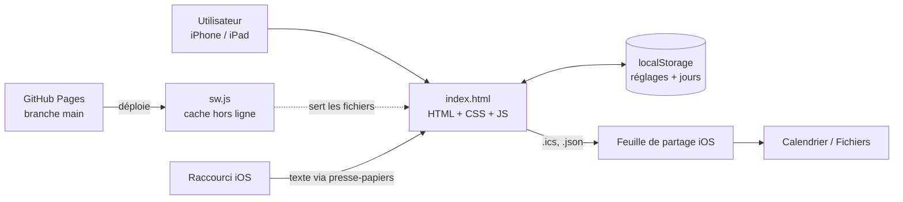
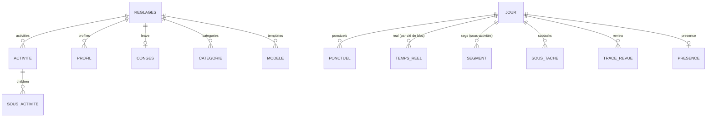
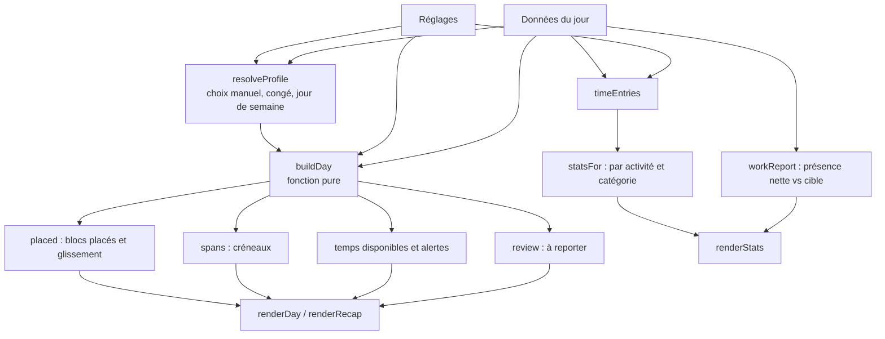
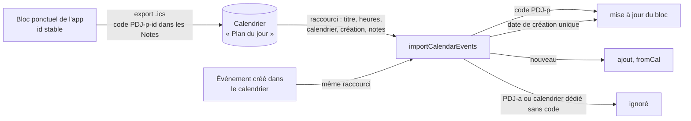

# ARCHITECTURE — Plan du jour

Vue d'ensemble du fonctionnement de l'app. Les **règles de travail** sont dans [CONVENTIONS.md](CONVENTIONS.md), l'**avancement par lot** dans [STATUS.md](STATUS.md), l'**historique des opérations** dans [CARNET.md](CARNET.md).

Version décrite : **0.17.1**.

## 1. Principe

Une PWA (application web installable) pour iPhone et iPad. **Un seul fichier de code** (`index.html` : HTML + CSS + JavaScript), aucun framework, aucune dépendance, aucun serveur. Toutes les données restent dans le `localStorage` de l'appareil. Le service worker met l'app en cache pour qu'elle fonctionne hors ligne.

## 2. Fichiers

| Fichier | Rôle |
|---|---|
| `index.html` | Toute l'app (≈ 2 580 lignes) |
| `sw.js` | Service worker : cache `plandujour-<version>`, hors ligne |
| `manifest.json` | Manifeste PWA (nom, icônes, plein écran) |
| `icon-180.png`, `icon-192.png`, `icon-512.png` | Icônes |
| `CONVENTIONS.md` | Règles et décisions de conception, par lot |
| `STATUS.md` | État par lot, « fini veut dire », points à valider |
| `CARNET.md` | Journal daté de toutes les opérations |
| `ARCHITECTURE.md` | Ce fichier |

`APP_VERSION` (dans `index.html`) et `VERSION` (dans `sw.js`) doivent avoir la même valeur (CONVENTIONS §10).

## 3. Structure du script (`index.html`)

Sections dans un ordre fixe, repérées par `// ==== N. NOM ====`.

| Section | Contenu |
|---|---|
| 1. CONFIG | Clés de stockage, versions de données, constantes |
| 2. TEMPS | Lecture et affichage des heures (minutes depuis minuit, `HH:MM` 24 h), dates |
| 3. VALEURS PAR DÉFAUT | Réglages de départ, activités, profils, catégories, `emptyDay` |
| 4. STOCKAGE | Lecture, migration et nettoyage (`sanitize`, `sanitizeDays`), écriture |
| 5. VALIDATION | Contrôle des saisies |
| 5B. PLANNING | Cœur métier pur : `resolveProfile`, `buildDay`, `timeEntries`, `statsFor`, `workReport` |
| 6. VUE | Rendu des quatre onglets et des éditeurs |
| 7. ÉVÉNEMENTS | Actions : chrono, calendrier, export / import, revue du jour, panneau d'un bloc |
| 8. INIT | Démarrage, enregistrement du service worker |

`window.PDJ` expose quelques fonctions pures (`buildDay`, `statsFor`, `workReport`, `calendarEvents`…) pour les tests automatisés.

## 4. Écrans

Quatre onglets : **Jour**, **Récapitulatif**, **Stats**, **Réglages**.

| Onglet | Rôle | Fonctions principales |
|---|---|---|
| Jour | Plan de la journée en frise, chrono, présence, sous-tâches, revue du jour, recherche | `renderDay` |
| Récapitulatif | Semaine réelle (vrais profils, congés, reports) ou semaine type | `renderRecap` |
| Stats | Jour / semaine / mois : travail (présence) face à 7 h 42, par catégorie, par activité | `renderStats` |
| Réglages | Profils, congés, activités, catégories, tâches habituelles, sauvegarde, calendrier | éditeurs de la section 6 |

## 5. Données

Deux objets JSON versionnés, plus des copies de sécurité.

| Clé `localStorage` | Contenu | Version |
|---|---|---|
| `plandujour.reglages` | Réglages : activités, profils, congés, catégories, modèles de tâches, cible de travail | `DATA_VERSION = 3` |
| `plandujour.jours` | Données par date (`YYYY-MM-DD`) | `DAYS_VERSION = 2` |
| `plandujour.jours.sauvegarde` | Copie brute si les jours sont illisibles | — |
| `plandujour.avant-import.reglages` / `.jours` | État précédent, gardé avant un import (une génération) | — |

Un jour (`emptyDay`) : `{ real, ponctuels, subtasks, review, profile, segs, presence }`.

Clé d'un bloc : `act:<id>` pour une activité de Réglages, `p:<id>` pour un bloc ponctuel du jour.

Changer un format impose d'incrémenter la version **et** d'écrire la migration (CONVENTIONS §7). Les champs additifs facultatifs, lus avec une valeur par défaut, n'en demandent pas.

## 6. Calcul d'une journée

- **Profil du jour** : choix manuel pour le jour, sinon congé (si la date est dans une période), sinon le profil dont les jours contiennent le jour de la semaine, sinon le premier.
- **Comportement d'un bloc** : `fixed` (heure fixe), `flex` (glisse si ce qui précède déborde), `free` (sans heure, lancé au chrono).
- **Chrono** : un seul chrono d'activité à la fois (`closeRunning`) ; la présence au travail est un chrono à part, en parallèle.
- **Temps de travail** : uniquement la présence nette des pauses, comparée à la cible (462 min = 7 h 42), du lundi au vendredi hors congés.

## 7. Échanges avec l'extérieur

| Flux | Sens | Format | Détail |
|---|---|---|---|
| Export / import de sauvegarde | app ↔ Fichiers | JSON (`app: 'plandujour'`, `format: 1`) | Import validé par `sanitize` ; modes « tout remplacer » ou « réglages seulement » |
| Export vers Calendrier | app → Calendrier | `.ics` (UID `pdj-p-<id>` ou `pdj-<date>-<clé>`, code dans les Notes) | Jours suivants seulement ; **seulement les blocs avec rappel** ; blocs `noCal` et `fromCal` exclus ; rappels `VALARM` ; à ajouter dans un calendrier dédié « Plan du jour » |
| Import de rendez-vous | Calendrier → app | texte `AAAA-MM-JJ HH:MM HH:MM Titre \| Calendrier \| AAAAMMJJHHMMSS \| Notes` (raccourci iOS, presse-papiers) ou `.ics` | Reconnaît par code (Notes) puis par date de création (`calKey`) et met à jour ; sinon ajoute des blocs ponctuels marqués `fromCal` ; titres de `calIgnore` ignorés ; doublon exact évité |

Aucune donnée n'est envoyée à un serveur : GitHub ne reçoit que le code.

## 8. Déploiement

GitHub Pages, branche `main`, racine du dépôt, chemins relatifs. Le service worker n'est pas enregistré sur `localhost` (sauf `?sw=1`) pour ne pas servir de vieux fichiers en développement. Un changement de version vide l'ancien cache.

## 9. Tests

Dossier `tests/` : vérifications en navigateur automatisé (Chromium piloté par Python et Playwright), voir `tests/README.md`. Les anciens `test_lot*.js` cités dans `STATUS.md` et `CONVENTIONS.md` ne sont pas dans le dépôt (perdus avec les sessions précédentes) ; les nouveaux tests les remplacent un domaine à la fois.
